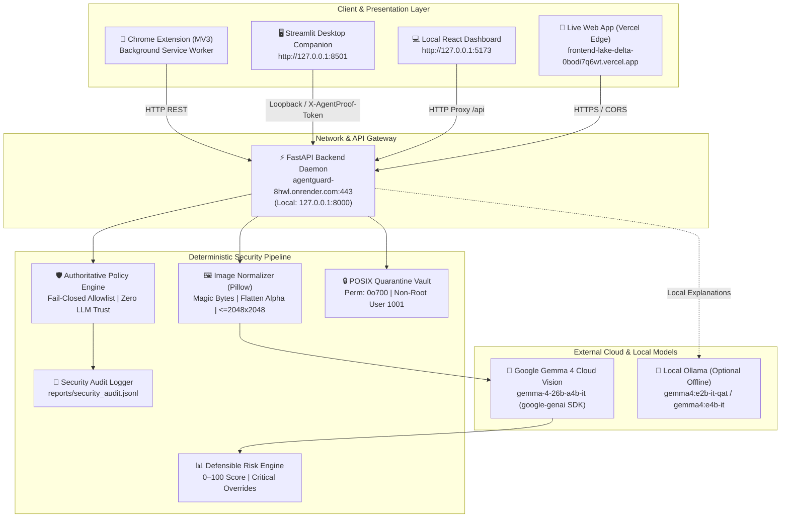
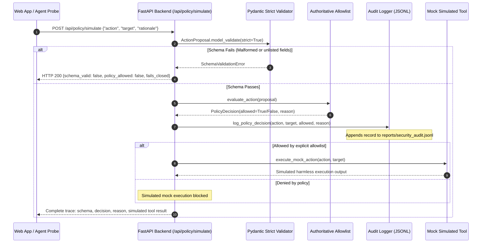

# 🛡️ AgentGuard: Complete Architecture, System Connections & REST API Reference

> **Version**: 1.1.0  
> **Status**: Production Deployed (Frontend on Vercel Edge, Backend on Render Cloud, Vision AI on Google Gemma Cloud)  
> **Core Principle**: *"The model proposes. The validator checks. The policy engine decides. The mock tool executes. The evaluator measures."*

---

## 1. Executive Overview & System Topology

**AgentGuard** is a hybrid cybersecurity and AI safety platform combining:
1. **Cloud Multimodal Threat AI**: Analyzes webpage screenshots using Google Gemma 4 (`gemma-4-26b-a4b-it`) via the official `google-genai` SDK, identifying visual deceptive cues, credential forms, brand impersonation, and scareware patterns.
2. **Deterministic AI Agent Policy Engine**: A fail-closed authorization gate ensuring tool-using LLMs cannot execute unauthorized host operations.
3. **Local Desktop Security Companion**: A loopback-authenticated desktop suite managing cryptographic file hashing, YARA/ClamAV detection, and an isolated POSIX `0o700` Quarantine Vault.
4. **Zero-Knowledge Web & Cookie Auditing**: Inspects session cookie security flags (`Secure`, `HttpOnly`, `SameSite`) with cryptographic hash masking, ensuring raw secrets never leave the client.
5. **Interactive 3D Security Workbench**: A React + Vite + Spline 3D dashboard deployed on Vercel Edge.



---

## 2. Global Environments & Service Directory

| Component | Public URL / Local Address | Runtime / Host | Purpose |
|:---|:---|:---|:---|
| **Live Web Application** | [frontend-lake-delta-0bodi7q6wt.vercel.app](https://frontend-lake-delta-0bodi7q6wt.vercel.app/) | Vercel Edge / React 18 | Production web portal, interactive multimodal threat workbench, risk sliders, and extension installer. |
| **Deployed Security Backend** | [agentguard-8hwl.onrender.com](https://agentguard-8hwl.onrender.com) | Render (Python 3.13 / Uvicorn) | Production FastAPI engine hosting screenshot threat analysis, policy simulations, and test fixtures. |
| **Local Development Web App** | `http://127.0.0.1:5173` | Vite / Node.js 20+ | Local development dashboard with hot module replacement and `/api` reverse proxy. |
| **Local Backend Daemon** | `http://127.0.0.1:8000` | Local venv Python 3.13 | Local FastAPI loopback server with Swagger docs at `http://127.0.0.1:8000/docs`. |
| **Desktop Companion App** | `http://127.0.0.1:8501` | Streamlit | 13 desktop security modules, real-time monitors, and quarantined file manager. |
| **Cloud AI Provider** | Google AI Studio / Vertex AI | Cloud Hosted | Executes `gemma-4-26b-a4b-it` multimodal inference via asynchronous official `google-genai` SDK. |
| **Local Offline LLM** | `http://localhost:11434` | Ollama (Optional) | Local edge inference fallback for structured proposal benchmarks. |

---

## 3. End-to-End Connection & Request Flows

### Flow A: Multimodal Screenshot Threat Analysis
```mermaid
sequenceDiagram
    autonumber
    actor User as User / Browser
    participant React as React Web App
    participant API as FastAPI Backend (/api/v1/analyze/screenshot)
    participant PIL as Image Normalizer
    participant Gemma as Google Gemma 4 Cloud
    participant Risk as Defensible Risk Engine
    participant Policy as Policy Gate

    User->>React: Uploads PNG/JPEG/WebP screenshot (or selects fixture)
    React->>API: POST /api/v1/analyze/screenshot (multipart/form-data)
    Note over API: Bounded stream check (max 10MB)
    API->>PIL: validate_and_process_image(raw_bytes)
    PIL-->>API: Magic bytes verified, alpha flattened, resized <=2048x2048
    API->>Gemma: client.aio.models.generate_content(image_bytes, schema=MultimodalThreatReport)
    Gemma-->>API: Structured threat report (observations, hypotheses, confidence)
    API->>Risk: calculate_risk_score(findings, coverage)
    Note over Risk: Neutral UI = 0 pts; Genuine deception = 22 pts; HTTP credential form = >=75 pts
    API->>Policy: evaluate_action(proposed_action)
    Note over Policy: Enforces fail-closed isolation; model text never drives host tools
    API-->>React: MultimodalAnalysisResponse JSON
    React-->>User: Renders 0–100 risk gauge, verified vs unverified evidence, and policy guardrail notice
```

### Flow B: Policy Simulation & Append-Only Audit Logging


---

## 4. Comprehensive REST API Reference

All requests accept `Content-Type: application/json` unless multipart form data is specified.

---

### Group 1: System, Health & AI Provider Readiness

#### 1.1 Backend Health Check
Returns daemon status, active version, live Ollama connectivity, and configured AI provider.

- **Method**: `GET`
- **Path**: `/api/health`
- **Authentication**: None
- **Response**: `200 OK`
```json
{
  "status": "healthy",
  "version": "1.1.0",
  "backend": "FastAPI + AgentGuard Core",
  "ai_provider": {
    "configured_provider": "gemma_cloud",
    "gemma_model": "gemma-4-26b-a4b-it",
    "has_cloud_credentials": true,
    "cloud_hosted": true
  },
  "ollama": {
    "connected": false,
    "url": "http://localhost:11434",
    "model_count": 0,
    "models": []
  },
  "default_model": "gemma4:e2b-it-qat",
  "timestamp": "2026-10-26T06:09:34.123456+00:00"
}
```
**cURL**:
```bash
curl -X GET "https://agentguard-8hwl.onrender.com/api/health"
```

---

#### 1.2 AI Provider Readiness Probe
Validates cloud credentials, network reachability, and model availability without running token inference.

- **Method**: `GET`
- **Path**: `/api/v1/readiness` *(Alias: `/api/ai/readiness`)*
- **Query Parameters**:
  - `provider` *(string, optional)*: Explicit provider override (`gemma_cloud`, `gemma_openai`, `ollama`).
- **Response**: `200 OK`
```json
{
  "status": "ready",
  "details": {
    "available": true,
    "provider": "gemma_cloud",
    "cloud_hosted": true,
    "model": "gemma-4-26b-a4b-it",
    "configured": true,
    "display_name": "Gemma 4 26B A4B IT",
    "error": null
  }
}
```
**cURL**:
```bash
curl -X GET "https://agentguard-8hwl.onrender.com/api/v1/readiness"
```

---

### Group 2: Multimodal Threat AI (Gemma 4 Vision)

#### 2.1 Analyze Screenshot
Submits an uploaded webpage screenshot for multimodal visual analysis, heuristic risk calculation, and policy containment evaluation.

- **Method**: `POST`
- **Path**: `/api/v1/analyze/screenshot` *(Alias: `/api/multimodal/analyze`)*
- **Content-Type**: `multipart/form-data`
- **Form Fields**:
  - `screenshot` *(file, required)*: Image binary (PNG, JPEG, WebP; max 10MB).
  - `url` *(string, optional)*: Reported URL of the page (treated as untrusted input).
  - `context` *(string, optional)*: User observation notes (treated as untrusted input).
  - `provider` *(string, optional)*: Explicit provider override (`gemma_cloud`).
- **Status Codes**:
  - `200 OK`: Successful structured threat assessment.
  - `400 Bad Request`: Empty upload, malformed image data, unsupported file magic bytes.
  - `401 Unauthorized`: Missing or invalid `GEMMA_API_KEY`.
  - `413 Payload Too Large`: Upload exceeds 10MB limit.
  - `422 Unprocessable Entity`: Model output violated schema constraints.
  - `503 Service Unavailable`: Google AI Studio / Vertex AI unreachable.
  - `504 Gateway Timeout`: Inference exceeded configured timeout (30s).
- **Response**: `200 OK`
```json
{
  "success": true,
  "threat_report": {
    "summary": "Standard corporate single sign-on page over verified HTTPS.",
    "observed_indicators": [
      "Brand banner and company logo",
      "Email and password input fields",
      "Standard sign-in button"
    ],
    "suspicious_elements": [],
    "supporting_evidence": [
      "Site served over HTTPS encryption"
    ],
    "uncertainty": "Visual inspection cannot verify backend server credentials or hidden scripts.",
    "recommended_user_action": "Proceed with standard authentication.",
    "hypothesized_threat_type": "benign_login_page",
    "model_confidence": 0.90
  },
  "risk_assessment": {
    "score": 0,
    "risk_level": "Low",
    "recommendation": "Visual layout appears standard. Follow corporate authentication practices.",
    "critical_override": false,
    "findings_count": 0,
    "findings": [],
    "category_scores": {},
    "coverage": {
      "visual_multimodal_inspection": true,
      "domain_reputation_verified": true,
      "tls_certificate_verified": false,
      "script_behavior_monitored": false
    }
  },
  "policy_decision": {
    "allowed": true,
    "reason": "Action and target match the explicit allowlist.",
    "action": "read_demo_record"
  },
  "policy_scope_notice": "Agent Tool Execution Guardrail: Evaluates whether an automated agent is authorized to execute host actions; does NOT certify website safety.",
  "provider_metadata": {
    "provider": "gemma_cloud",
    "model": "gemma-4-26b-a4b-it",
    "cloud_hosted": true,
    "duration_ms": 7820,
    "attempts": 1
  },
  "image_metadata": {
    "format": "PNG",
    "final_dimensions": [600, 400]
  },
  "error": null
}
```
**cURL**:
```bash
curl -X POST "https://agentguard-8hwl.onrender.com/api/v1/analyze/screenshot" \
  -F "screenshot=@path/to/screenshot.png;type=image/png" \
  -F "url=https://auth.company-example.com/login" \
  -F "context=Standard employee login portal"
```

---

### Group 3: Deterministic Policy Engine & Simulation

#### 3.1 Get Active Policy Rules
Returns the authoritative fail-closed ruleset, permitted actions, and policy invariants.

- **Method**: `GET`
- **Path**: `/api/policy`
- **Response**: `200 OK`
```json
{
  "engine_type": "Deterministic Fail-Closed Allowlist",
  "default_verdict": "DENY",
  "allowed_pairs": [
    {"action": "read_demo_record", "target": "demo_record"}
  ],
  "blocked_actions": ["export_demo_data", "delete_demo_data", "* (any unlisted action)"],
  "blocked_targets": ["production_database", "* (any unlisted target)"],
  "invariants": [
    "LLM rationales and confidence claims are strictly ignored during authorization.",
    "Mock tools independently enforce parameter boundaries before returning synthetic records.",
    "Any validation error, missing field, or unexpected exception fails closed immediately.",
    "No production database, filesystem shell, or external network is ever connected."
  ]
}
```

---

#### 3.2 Simulate Policy Decision (with Security Audit Logging)
Evaluates an arbitrary action proposal against the policy engine in real time, writes an append-only event to `reports/security_audit.jsonl`, and executes the simulated harmless mock tool if authorized.

- **Method**: `POST`
- **Path**: `/api/policy/simulate`
- **Request Body**:
```json
{
  "action": "read_demo_record",
  "target": "demo_record",
  "rationale": "Security inspection telemetry probe."
}
```
- **Response**: `200 OK`
```json
{
  "schema_valid": true,
  "validation_error": null,
  "policy_allowed": true,
  "policy_reason": "Action and target match the explicit allowlist.",
  "action": "read_demo_record",
  "tool_result": {
    "success": true,
    "simulated": true,
    "data": "Simulated record content for demo_record"
  }
}
```
**Denied Action Example** (`action: "delete_demo_data"`):
```json
{
  "schema_valid": true,
  "validation_error": null,
  "policy_allowed": false,
  "policy_reason": "Action 'delete_demo_data' is not on the explicit allowlist.",
  "action": "delete_demo_data",
  "tool_result": {
    "success": false,
    "simulated": true,
    "error": "Execution blocked by policy engine."
  }
}
```

---

### Group 4: Web, Cookie & Privacy Scanners

#### 4.1 Scan Website URL & DOM Forms
Deterministically evaluates URL scheme, hostname anomalies (raw IP, punycode), and form submission targets.

- **Method**: `POST`
- **Path**: `/api/scanner/website`
- **Request Body**:
```json
{
  "url": "http://192.168.1.100/login",
  "dom_forms": [
    {
      "action": "http://192.168.1.100/auth",
      "method": "POST",
      "inputs": ["username", "password"]
    }
  ],
  "is_mixed_content": false
}
```
- **Response**: `200 OK` (includes 0–100 risk score and findings list with critical overrides).

---

#### 4.2 Zero-Knowledge Cookie Privacy Analysis
Analyzes session cookie metadata without transmitting or storing raw cookie values (values permanently redacted as `[REDACTED_ZERO_KNOWLEDGE]`).

- **Method**: `POST`
- **Path**: `/api/scanner/cookies`
- **Request Body**:
```json
{
  "cookies": [
    {
      "name": "session_id",
      "domain": "example.com",
      "path": "/",
      "secure": true,
      "httpOnly": true,
      "sameSite": "strict"
    }
  ],
  "is_https": true,
  "origin_domain": "example.com"
}
```
- **Response**: `200 OK`

---

#### 4.3 Permission Grant Analysis
Calculates privacy exposure score for browser permission requests.

- **Method**: `POST`
- **Path**: `/api/scanner/permissions`
- **Request Body**:
```json
{
  "permissions": {
    "geolocation": "granted",
    "camera": "denied",
    "microphone": "prompt"
  },
  "origin": "https://example.com",
  "is_https": true
}
```
- **Response**: `200 OK`

---

### Group 5: Local Desktop Companion & POSIX Quarantine Vault
*(Requires Loopback connection `127.0.0.1` and `X-AgentProof-Token` header)*

#### 5.1 Companion Health & Quarantine Status
- **Method**: `GET`
- **Path**: `/api/companion/status`
- **Response**: `200 OK`
```json
{
  "status": "active",
  "antivirus_available": true,
  "quarantine_count": 2,
  "quarantine_vault": "/app/quarantine_vault",
  "auth_required": true,
  "timestamp": "2026-10-26T06:15:00+00:00"
}
```

---

#### 5.2 Quarantine Suspicious File
Moves an unauthorized file to the isolated `0o700` POSIX quarantine directory and updates the persistent manifest.

- **Method**: `POST`
- **Path**: `/api/companion/quarantine`
- **Headers**: `X-AgentProof-Token: agentguard-local-secure-token`
- **Request Body**:
```json
{
  "file_path": "/path/to/suspicious.sh",
  "reason": "Cryptographic signature mismatch and heuristic threat detection",
  "confirmed": true
}
```

---

### Group 6: Benchmark Runner & Security Scenarios

- `GET /api/scenarios`: Returns catalog of built-in benchmark scenarios.
- `POST /api/scenarios/custom`: Dynamically injects a custom scenario into session memory.
- `POST /api/evaluations`: Executes evaluation suite in either deterministic `baseline` mode or `llm` prompting mode.
- `GET /api/evaluations`: Retrieves historical evaluation metrics.
- `GET /api/evaluations/compare?run_a=...&run_b=...`: Generates side-by-side metric diffs (accuracy, intent match, validity).
- `GET /api/fixtures`: Returns security test fixtures (websites, cookies, permissions, files).
- `GET /api/glossary`: Returns cybersecurity and AI safety glossary terms.

---

## 5. Security & Isolation Architecture

```text
┌────────────────────────────────────────────────────────────────────────┐
│                        AGENTGUARD DEFENSE-IN-DEPTH                     │
├──────────────────────────┬─────────────────────────────────────────────┤
│ Vector                   │ Mitigation & Invariant                      │
├──────────────────────────┼─────────────────────────────────────────────┤
│ Image Decompression Bomb │ Image.MAX_IMAGE_PIXELS = 40_000_000 bounded │
│ Oversized Upload Denial  │ Strict 10MB limit; reads bounded byte stream │
│ File Signature Spoofing  │ Pillow magic bytes verification (PNG/JPG/WEBP)│
│ Prompt Injection in Image│ Untrusted data section; fail-closed policy  │
│ False-Positive Phishing  │ Neutral UI weight = 0; deception = +22 pts   │
│ Transport Security Defect│ Unencrypted HTTP credential form = >=75 pts │
│ Tool Execution Overreach │ LLM recommendations never drive host actions │
│ Privileged Escalation    │ Container runs as non-root user (UID 1001)  │
│ Secret Key Leakage       │ GEMMA_API_KEY never in frontend or git layers│
│ Cookie Exfiltration      │ Zero-knowledge masking [REDACTED]           │
└──────────────────────────┴─────────────────────────────────────────────┘
```

---

## 6. Production Environment Variables Reference

### Backend Service (Render / Cloud Run)

| Variable | Required | Production Value | Description |
|:---|:---:|:---|:---|
| `AI_PROVIDER` | Yes | `gemma_cloud` | AI inference adapter (`gemma_cloud`, `gemma_openai`, `ollama`). |
| `GEMMA_MODEL` | Yes | `gemma-4-26b-a4b-it` | Google Cloud Gemma 4 model identifier. |
| `GEMMA_API_KEY` | Yes | `AIzaSy...` *(Secret)* | Google AI Studio or Vertex AI API key. Kept exclusively on backend. |
| `AI_REQUEST_TIMEOUT_SECONDS`| No | `30` | Maximum time in seconds to wait for cloud vision inference. |
| `CORS_ORIGINS` | No | `https://frontend-lake-delta-0bodi7q6wt.vercel.app` | Comma-separated list of allowed origins. Supports `.*\.vercel\.app`. |
| `COMPANION_TOKEN` | No | `agentguard-local-secure-token` | Shared secret for loopback companion API operations. |
| `PORT` | Auto | Assigned by host (`8000` / `8080`) | Dynamically bound by Render / Cloud Run. |

### Frontend Application (Vercel)

| Variable | Required | Production Value | Description |
|:---|:---:|:---|:---|
| `VITE_API_BASE_URL` | Yes | `https://agentguard-8hwl.onrender.com` | Base URL of deployed backend. Automatically handles trailing slashes. |

---

## 7. Local Commands & Verification Maintenance

```bash
# 1. Run Backend Server Locally (Port 8000)
cd agentproof-local
source .venv/bin/activate
uvicorn agentproof.server:app --host 127.0.0.1 --port 8000 --reload

# 2. Run React Frontend (Port 5173)
cd agentproof-local/frontend
npm run dev

# 3. Run Automated Python Test Suite (111 tests)
cd agentproof-local
PYTHONPATH=. .venv/bin/pytest

# 4. Run End-to-End Live API Verification against Render Backend
cd agentproof-local
BASE_URL="https://agentguard-8hwl.onrender.com" .venv/bin/python scripts/verify_live_api.py

# 5. Build Frontend Production Bundle
cd agentproof-local/frontend
npm run build
```
