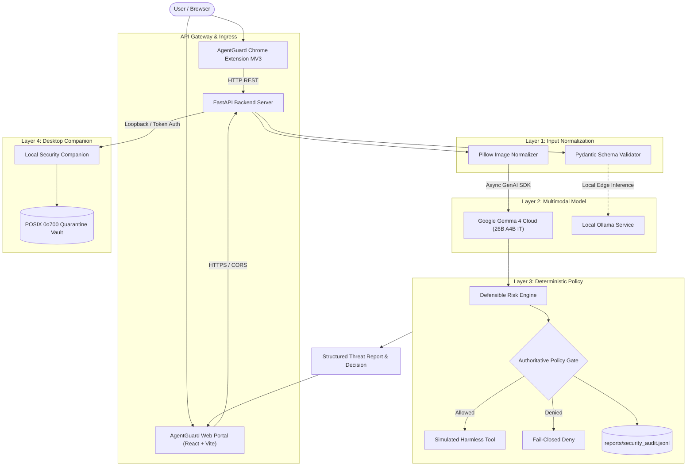

# 🛡️ AgentGuard

<div align="center">

<h3>Your Intelligent Shield Against Malicious Websites</h3>

<p>
  An AI-assisted browser security project designed to help users identify potentially malicious websites, strengthen browsing safety, and manage security-related actions through a browser extension and local companion service.
</p>

<p>
  <a href="https://agentguard-zeta.vercel.app/"></a>
  <a href="https://agentguard-8hwl.onrender.com/api/health"></a>
  <a href="https://github.com/shreyash-bhosale/AgentGuard"></a>
  <a href="#-testing-and-verification"></a>
  <a href="./SECURITY.md"></a>
  <a href="./LICENSE"></a>
</p>

<p>
  <strong>Built for Hacktoberfest · AI Security · Browser Protection</strong>
</p>

<p align="center">
  
</p>

</div>

---

## 📌 Table of Contents

- [🔍 Overview](#-overview)
- [🎯 Problem Statement](#-problem-statement)
- [💡 Our Solution](#-our-solution)
- [✨ Core Features](#-core-features)
  - [1. Cloud Multimodal Threat AI (Gemma 4 Vision)](#1-cloud-multimodal-threat-ai-gemma-4-vision)
  - [2. Website Risk Engine & Critical Overrides](#2-website-risk-engine--critical-overrides)
  - [3. Zero-Knowledge Cookie Privacy Auditor](#3-zero-knowledge-cookie-privacy-auditor)
  - [4. Deterministic AI Agent Policy Engine & Simulation](#4-deterministic-ai-agent-policy-engine--simulation)
  - [5. Desktop Security Companion & Quarantine Vault](#5-desktop-security-companion--quarantine-vault)
  - [6. Interactive FastAPI Swagger Daemon](#6-interactive-fastapi-swagger-daemon)
- [🏗️ System Architecture](#️-system-architecture)
- [🛡️ Security Architecture](#️-security-architecture)
- [🧰 Technology Stack](#-technology-stack)
- [📂 Project Structure](#-project-structure)
- [🚀 Getting Started](#-getting-started)
- [⚙️ Environment Variables](#️-environment-variables)
- [💻 Running Locally](#-running-locally)
- [🧪 Testing and Verification](#-testing-and-verification)
- [☁️ Deployment](#️-deployment)
- [🔒 Security Best Practices](#-security-best-practices)
- [⚠️ Limitations](#️-limitations)
- [🛣️ Future Improvements](#️-future-improvements)
- [🤝 Contributing](#-contributing)
- [👥 Contributors](#-contributors)
- [📄 License](#-license)
- [🙌 Acknowledgements](#-acknowledgements)

---

## 🔍 Overview

**AgentGuard** is an open-source browser security project focused on reducing the risks associated with malicious websites, suspicious browsing activity, and unsafe interactions on the web.

The project combines a browser-facing interface, a FastAPI security engine, and a cloud-hosted open-weight multimodal AI model (**Google Gemma 4 Vision**) to support real-time security analysis.

AgentGuard is designed around three foundational priorities:
1. **Proactive protection**: Help identify potentially dangerous websites and deceptive cues before users submit credentials or interact with them.
2. **Privacy-conscious processing**: Keep private AI provider credentials exclusively on the backend; never expose API keys in frontend code, client bundles, or git history.
3. **Practical security controls**: Combine empirical heuristics, deterministic policy enforcement, clear visual feedback, and verifiable audit workflows.

> [!NOTE]
> The actual protection available depends on the installed extension, configured backend, enabled integrations, and implemented security checks.

---

## 🎯 Problem Statement

Modern web users regularly encounter phishing pages, deceptive links, malicious redirects, suspicious permission requests, and websites designed to harvest credentials.

Traditional browser warnings are valuable, but users can still struggle to evaluate unfamiliar websites and understand the risks associated with their actions:
- **Visual Deception**: Phishing sites often mimic genuine corporate brand layouts, logos, and fonts while serving over plain HTTP or unregistered domains.
- **Over-Reliance on Probabilistic AI**: Allowing an AI model's text recommendation to authorize destructive or privileged host actions (e.g. file deletion, credential modification) introduces serious prompt-injection and intent-drift risks.
- **Privacy Trade-offs**: Most commercial security extensions upload full unencrypted browsing history and raw cookies to third-party tracking servers.

AgentGuard explores how browser-level controls, zero-knowledge privacy, and deterministic AI governance work together to help users make safer browsing decisions.

---

## 💡 Our Solution

AgentGuard unites proactive browser security, cloud multimodal computer vision, and deterministic policy governance into a unified architecture.

```text
The Core Invariant:
"The model proposes. The validator checks. The policy engine decides. The mock tool executes. The evaluator measures."
```

### The End-to-End Workflow:
1. **Encounter**: A user encounters a website URL or captures a suspicious webpage screenshot.
2. **Client Validation**: The browser-facing component gathers only permitted metadata under strict privacy boundaries.
3. **Sanitized Normalization**: The backend verifies image magic bytes, bounds upload size ($\le 10\text{MB}$), flattens alpha channels, and scales dimensions ($\le 2048\times 2048$) to prevent decompression bomb exploits.
4. **Multimodal Analysis**: Google Gemma 4 (`gemma-4-26b-a4b-it`) extracts structured threat indicators, separates verified technical facts from unverified hypotheses, and notes visual uncertainty.
5. **Calibrated Risk Scoring**: Neutral observations (standard login inputs) add 0 points. Genuine deceptive cues add calibrated weights. Unencrypted HTTP credential forms trigger a critical override ($\ge 75$ Critical Risk).
6. **Deterministic Policy Gate**: The model's advice is treated as untrusted text. It never drives privileged operations.
7. **Action Execution**: Harmless simulated mock tools execute only if permitted by an explicit, fail-closed allowlist.

---

## ✨ Core Features

### 1. Cloud Multimodal Threat AI (Gemma 4 Vision)
Upload screenshots of suspicious pages (or select from curated fixtures: *Benign Corporate SSO*, *Deceptive Phishing Portal*, *Scareware Alert*, *Prompt Injection Probe*). Google Gemma 4 analyzes visual elements in real time and streams structured reports containing confidence scores, observations, and explicit limitations.

### 2. Website Risk Engine & Critical Overrides
Evaluate live URLs or DOM forms using heuristic scoring. Plain HTTP forms requesting passwords automatically trigger an authoritative **Critical Override** ($\ge 75/100$) regardless of other neutral parameters.

<p align="center">
  
</p>

---

### 3. Zero-Knowledge Cookie Privacy Auditor
Inspect session cookie security metadata (`Secure`, `HttpOnly`, `SameSite`, expiration). Raw cookie values are cryptographically hashed and masked as `[REDACTED_ZERO_KNOWLEDGE]` before analysis, ensuring secrets never touch log files or external providers.

<p align="center">
  
</p>

---

### 4. Deterministic AI Agent Policy Engine & Simulation
Test arbitrary action proposals against an authoritative allowlist. Provides an audit trace of schema validation, policy evaluation, mock tool execution, and append-only audit logging to `reports/security_audit.jsonl`.

<p align="center">
  
</p>

---

### 5. Desktop Security Companion & Quarantine Vault
Local-first desktop application featuring cryptographic file hashing (SHA-256), YARA signature checks, antivirus integration, and an isolated POSIX `0o700` Quarantine Vault with audit manifests.

<p align="center">
  
</p>

---

### 6. Interactive FastAPI Swagger Daemon
The backend provides interactive OpenAPI documentation at `/docs`, enabling developers to test screenshot analysis, policy simulation, and scenario evaluations directly from their browser.

<p align="center">
  
</p>

---

## 🏗️ System Architecture



### Core Architecture Principles:
- **Separation of Concerns**: Browser UI, backend validation, AI inference, and policy authorization have distinct boundaries.
- **Credential Isolation**: AI secrets remain exclusively in server environment variables.
- **Request Validation**: Image magic bytes, dimensions, and MIME types are validated before invoking cloud AI.
- **Controlled Permissions**: Browser extension and local companion capabilities use the minimum required permissions.
- **Graceful Failure**: AI provider timeouts or network drops fail safely and explicitly.

---

## 🛡️ Security Architecture

| Security Area | Mitigation & Implementation |
|:---|:---|
| **Container Privileges** | Non-root system user `agentguard` (UID `1001`) with least-privilege folder permissions. |
| **AI Secret Protection** | `GEMMA_API_KEY` is loaded on the backend only; never bundled into `VITE_*` variables or git commits. |
| **Build Context Safety** | Strict `.dockerignore` files prevent `.env`, `.venv`, and build caches from entering container images. |
| **CORS Ingress** | Narrowly restricted to production frontend domains (`*.vercel.app`) and local development ports. |
| **Companion Auth** | Loopback binding (`127.0.0.1`) and `X-AgentProof-Token` authentication for companion endpoints. |
| **Decompression Bomb Defense** | Pillow bounded with `Image.MAX_IMAGE_PIXELS = 40_000_000` and a strict 10MB upload limit. |
| **Cookie Privacy** | Full zero-knowledge masking: session tokens are hashed and masked as `[REDACTED_ZERO_KNOWLEDGE]`. |
| **Error Handling** | Sanitized 500 error messages prevent internal stack traces or filesystem paths from leaking. |

> [!WARNING]
> **Security Disclaimer**: No security tool can guarantee detection of every malicious website. AI-based analysis can produce false positives and false negatives. AgentGuard is designed to complement, not replace, browser security updates, antivirus engines, and safe browsing habits.

---

## 🧰 Technology Stack

| Layer | Technologies |
|:---|:---|
| **Backend Framework** | FastAPI (Python 3.13), Uvicorn ASGI |
| **Multimodal AI Provider** | Google Gemma 4 (`gemma-4-26b-a4b-it`) via official `google-genai` SDK |
| **Image Processing** | Pillow (PIL) with magic bytes verification & dimension scaling |
| **Schema & Validation** | Pydantic v2 (Strict Schema Enforcement) |
| **Automated Testing** | Pytest, AnyIO, Starlette TestClient (111 tests) |
| **Frontend Framework** | React 18, Vite 6, TypeScript 5, TailwindCSS v4 |
| **UI Components** | Lucide React, Framer Motion, Spline 3D Runtime |
| **Desktop Companion** | Streamlit, POSIX filesystem security (`0o700`), YARA, ClamAV |
| **Browser Extension** | Chromium Manifest V3 (Background Service Worker, Content Scripts) |
| **Cloud Hosting** | **Vercel** (Frontend) & **Render** (Backend Docker Container) |

---

## 📂 Project Structure

```text
AgentGuard/
├── agentproof-local/
│   ├── agentproof/
│   │   ├── ai_provider.py         # Google Gemma 4 Cloud & Ollama inference abstraction
│   │   ├── multimodal_analyzer.py # Multimodal coordinator, prompt sandboxing & policy gate
│   │   ├── image_processor.py     # Screenshot validation, magic bytes & safe normalization
│   │   ├── policy_engine.py       # Authoritative deterministic fail-closed policy
│   │   ├── risk_engine.py         # Heuristic 0–100 risk scoring with critical overrides
│   │   ├── server.py              # FastAPI backend endpoints & CORS configuration
│   │   ├── config.py              # Pydantic configuration & environment resolution
│   │   ├── cookie_analyzer.py     # Zero-knowledge cookie security inspection
│   │   ├── file_scanner.py        # Cryptographic file hashing & antivirus scanner
│   │   ├── quarantine_manager.py  # Isolated POSIX 0o700 quarantine vault
│   │   └── website_scanner.py     # Deterministic URL and DOM form analyzer
│   ├── frontend/                  # React + Vite web application & Multimodal Threat UI
│   │   ├── src/
│   │   │   ├── components/
│   │   │   │   ├── analysis/      # MultimodalAnalysisView.tsx (Vision Threat UI)
│   │   │   │   └── dashboard/     # OverviewView, Navigation & Risk Sliders
│   │   │   └── lib/api.ts         # Hardened API client with timeout & base URL resolver
│   │   └── package.json
│   ├── chrome-extension/          # Manifest V3 browser protection extension
│   ├── tests/                     # 111 automated Python unit and integration tests
│   ├── scripts/                   # Evaluation scripts (eval_multimodal.py, verify_live_api.py)
│   ├── Dockerfile                 # Production non-root containerfile
│   ├── docker-compose.yml         # Container orchestration specification
│   ├── app.py                     # Streamlit desktop security companion
│   └── requirements.txt           # Python dependencies
├── docs/                          # Architectural assets and UI screenshots
├── FULL_SYSTEM_ARCHITECTURE_AND_API_REFERENCE.md # Complete REST API & flow specification
├── ARCHITECTURE.md                # System sequence diagrams & security invariants
├── SECURITY.md                    # Zero-knowledge boundaries & threat model
└── README.md
```

---

## 🚀 Getting Started

### Prerequisites
- **Git**
- **Python 3.11 or 3.13**
- **Node.js 20+** and **npm**
- **Google AI Studio API Key** (for Gemma 4 cloud inference)
- A Chromium-based browser (Chrome, Brave, Edge) if testing the extension

### 1. Clone the Repository
```bash
git clone https://github.com/shreyash-bhosale/AgentGuard.git
cd AgentGuard
```

### 2. Set Up the Python Backend
```bash
cd agentproof-local
python3 -m venv .venv
source .venv/bin/activate
pip install --upgrade pip
pip install -r requirements.txt
```

### 3. Configure Environment Variables
Copy the example environment configuration:
```bash
cp .env.example .env
```
Edit `.env` and configure your credentials:
```bash
AI_PROVIDER=gemma_cloud
GEMMA_MODEL=gemma-4-26b-a4b-it
GEMMA_API_KEY=your_google_ai_studio_api_key_here
AI_REQUEST_TIMEOUT_SECONDS=30
```

### 4. Install Frontend Dependencies
In a new terminal:
```bash
cd agentproof-local/frontend
npm install
```

---

## ⚙️ Environment Variables

### Backend Configuration (`agentproof-local/.env` or Render Dashboard)

| Variable | Required | Default / Example | Description |
|:---|:---:|:---|:---|
| `AI_PROVIDER` | Yes | `gemma_cloud` | AI provider adapter (`gemma_cloud`, `gemma_openai`, `ollama`). |
| `GEMMA_MODEL` | Yes | `gemma-4-26b-a4b-it` | Google Gemma model identifier. |
| `GEMMA_API_KEY` | Yes | `AIzaSy...` *(Secret)* | Google AI Studio or Vertex AI secret API key. |
| `AI_REQUEST_TIMEOUT_SECONDS`| No | `30` | Bounded inference request timeout (5–180 seconds). |
| `CORS_ORIGINS` | No | `https://agentguard-zeta.vercel.app` | Comma-separated allowed frontend origins. Supports `.*\.vercel\.app`. |
| `COMPANION_TOKEN` | No | `agentguard-local-secure-token`| Shared secret for local companion API operations. |
| `PORT` | Auto | Assigned by host (`8000`) | Dynamically bound port. |

### Frontend Configuration (`agentproof-local/frontend/.env` or Vercel Settings)

| Variable | Required | Value | Description |
|:---|:---:|:---|:---|
| `VITE_API_BASE_URL` | Yes | `https://agentguard-8hwl.onrender.com` | Deployed backend URL (or `http://127.0.0.1:8000` for local dev). |

> [!CAUTION]
> Variables prefixed with `VITE_` are bundled into client-side JavaScript. **Never put `GEMMA_API_KEY` into any `VITE_*` variable.**

---

## 💻 Running Locally

### Start the Backend Server
```bash
cd agentproof-local
source .venv/bin/activate
uvicorn agentproof.server:app --host 127.0.0.1 --port 8000 --reload
```
- Local API URL: `http://127.0.0.1:8000`
- Interactive OpenAPI Docs: `http://127.0.0.1:8000/docs`

### Start the React Frontend
In a separate terminal:
```bash
cd agentproof-local/frontend
npm run dev
```
Open your browser at:
`http://localhost:5173`

### Start the Desktop Companion (Optional)
```bash
cd agentproof-local
source .venv/bin/activate
streamlit run app.py
```
Open your browser at:
`http://127.0.0.1:8501`

---

## 🧪 Testing and Verification

AgentGuard includes a test suite covering image validation, model timeouts, prompt-injection containment, policy enforcement, and live cloud inference.

### 1. Run the Automated Python Test Suite
```bash
cd agentproof-local
source .venv/bin/activate
PYTHONPATH=. .venv/bin/pytest
```
**Actual Result: 111 Tests (110 passed, 1 live cloud test skipped for CI safety):**
```text
================== 110 passed, 1 skipped, 1 warning in 2.62s ===================
```

### 2. Run the Opt-In Live Cloud Inference Test
```bash
cd agentproof-local
RUN_LIVE_TESTS=1 PYTHONPATH=. .venv/bin/pytest tests/test_multimodal_gemma.py -k "test_live_cloud_inference"
# Passes against Google Gemma 4 Cloud in ~8 seconds.
```

### 3. Verify the Deployed Backend API
```bash
cd agentproof-local
BASE_URL="https://agentguard-8hwl.onrender.com" .venv/bin/python scripts/verify_live_api.py
```
**Output from live verification:**
```text
============================================================
AgentGuard End-to-End Multimodal Verification
============================================================
[PASS] 1. Backend Health Check: OK
[PASS] 2. Gemma Cloud Readiness: ready (Model: gemma-4-26b-a4b-it)
[PASS] 3. Benign Synthetic Login: Risk Score 0/100 (Low)
[PASS] 4. Suspicious Unencrypted Login: Risk Score 75/100 (Critical Override)
[PASS] 5. Invalid File Type Rejected with HTTP 400 Bad Request
============================================================
ALL END-TO-END VERIFICATION CHECKS PASSED SUCCESSFULLY!
============================================================
```

### 4. Build the Frontend Production Bundle
```bash
cd agentproof-local/frontend
npm run build
# Compiles 2047 modules into dist/ in ~2.4s with 0 errors.
```

---

## ☁️ Deployment

### Frontend — Vercel
- **Production URL**: [`https://agentguard-zeta.vercel.app`](https://agentguard-zeta.vercel.app/)
- **Configuration**: Set environment variable `VITE_API_BASE_URL=https://agentguard-8hwl.onrender.com` in Vercel Project Settings $\rightarrow$ Environment Variables $\rightarrow$ Redeploy.

### Backend — Render
- **Production URL**: [`https://agentguard-8hwl.onrender.com`](https://agentguard-8hwl.onrender.com)
- **Runtime**: Docker (using [`agentproof-local/Dockerfile`](file:///Users/shreyashbhosale/Desktop/AgentGuard/agentproof-local/Dockerfile)).
- **Configuration**: Configure `GEMMA_API_KEY`, `AI_PROVIDER=gemma_cloud`, `GEMMA_MODEL=gemma-4-26b-a4b-it`, and `CORS_ORIGINS` in the Render Environment tab.

### Alternative — Google Cloud Run
Deploy serverless container to Google Cloud:
```bash
gcloud run deploy agentguard-backend \
  --source agentproof-local/ \
  --platform managed \
  --region us-central1 \
  --allow-unauthenticated \
  --set-env-vars AI_PROVIDER=gemma_cloud,GEMMA_MODEL=gemma-4-26b-a4b-it,AI_REQUEST_TIMEOUT_SECONDS=30,CORS_ORIGINS=https://agentguard-zeta.vercel.app \
  --set-secrets GEMMA_API_KEY=GEMMA_API_KEY:latest
```

---

## 🔒 Security Best Practices

1. **Principle of Least Privilege**: The browser extension requests only the minimum permissions necessary. The Docker container executes as an unprivileged user (`agentguard`, UID 1001).
2. **Safe Browser Actions**: Protective operations are deterministic and auditable. AI outputs are treated as advisory and never authorize destructive host actions.
3. **Loopback Companion Boundaries**: The desktop companion service strictly enforces `127.0.0.1` binding and requires an `X-AgentProof-Token` header.
4. **Untrusted Content Isolation**: Webpage text, screenshots, and model outputs are treated as untrusted data.
5. **No Dangerous DOM Injection**: Plain-text rendering is used across the frontend. `dangerouslySetInnerHTML` is never used for AI output.

---

## ⚠️ Limitations

- **Screenshot Limitations**: Visual inspection cannot independently verify TLS certificates, DNS spoofing, or obfuscated backend scripts.
- **Probabilistic Signals**: AI models can produce false positives or false negatives.
- **Provider Availability**: Cloud AI inference depends on network connectivity and Google AI Studio service availability.
- **Simulated Environment Guardrails**: AgentProof Local evaluates tool actions against in-memory mock targets (`demo_record`, `production_database`) to avoid touching live resources.

---

## 🛣️ Future Improvements

- [ ] Dynamic Cedar or Rego policy rule editor in the web UI.
- [ ] Multi-turn agent trajectory evaluation benchmarks.
- [ ] Automated adversarial fuzzing and jailbreak prompt generators.
- [ ] Direct Chromium Extension Web Store release.
- [ ] Local WebGPU/ONNX client-side visual model inference.

---

## 🤝 Contributing

Contributions, bug reports, documentation improvements, and security-focused suggestions are welcome!

### How to Contribute:
1. Fork the repository.
2. Create a feature branch:
   ```bash
   git checkout -b feat/improve-security-analysis
   ```
3. Make your changes and verify with tests:
   ```bash
   PYTHONPATH=. .venv/bin/pytest
   ```
4. Commit your changes:
   ```bash
   git commit -m "feat: improve security analysis"
   ```
5. Push to your branch and open a Pull Request:
   ```bash
   git push origin feat/improve-security-analysis
   ```

---

## 👥 Contributors

A huge thank you to everyone who has contributed to making **AgentGuard** stronger, safer, and more resilient! 🛡️

<div align="center">

| Contributor | Role & Contributions | GitHub Profile |
| :---: | :--- | :---: |
| <a href="https://github.com/shreyash-bhosale"><br /><sub><b>Shreyash Bhosale</b></sub></a> | 🛡️ **Creator & Lead Maintainer**<br />• System Architecture & Deterministic Security Engines<br />• Full-Stack FastAPI Companion & React Frontend<br />• Multimodal Gemma AI Threat Detection & Cloud Deployments | [](https://github.com/shreyash-bhosale) |
| <a href="https://github.com/Pawansankhla07"><br /><sub><b>Pawan Sankhla</b></sub></a> | 🎨 **Open Source Contributor**<br />• Enhanced Launch Lab UI/UX (<a href="https://github.com/shreyash-bhosale/AgentGuard/pull/2">#2</a>)<br />• Improved user workflows and visual presentation | [](https://github.com/Pawansankhla07) |
| <a href="https://github.com/vaniarya965"><br /><sub><b>Vanishree Arya</b></sub></a> | 🔒 **Open Source Contributor**<br />• Implemented Policy Decision Security Audit Logging (<a href="https://github.com/shreyash-bhosale/AgentGuard/pull/1">#1</a>)<br />• Strengthened deterministic security verification suite | [](https://github.com/vaniarya965) |

</div>

<br />

> 💡 **Want to contribute?** Check out our [Contributing Guide](#-contributing) to get started! All contributions — from security tests and bug fixes to UI enhancements and documentation — are warmly welcomed.

---

## 📄 License

This project is licensed under the [MIT License](LICENSE).

---

## 🙌 Acknowledgements

AgentGuard is developed as a security-focused project exploring browser protection, AI-assisted analysis, and practical application security. Thanks to the open-source communities, Hacktoberfest, and the developers behind FastAPI, React, and Google Gemma for making this experimentation possible.

<div align="center">

**AgentGuard — Building safer browsing experiences through practical security engineering.**

[Live Frontend](https://agentguard-zeta.vercel.app/) · [Backend API](https://agentguard-8hwl.onrender.com/) · [GitHub Repository](https://github.com/shreyash-bhosale/AgentGuard)

*Security is a continuous process, not a one-time feature.*

</div>
