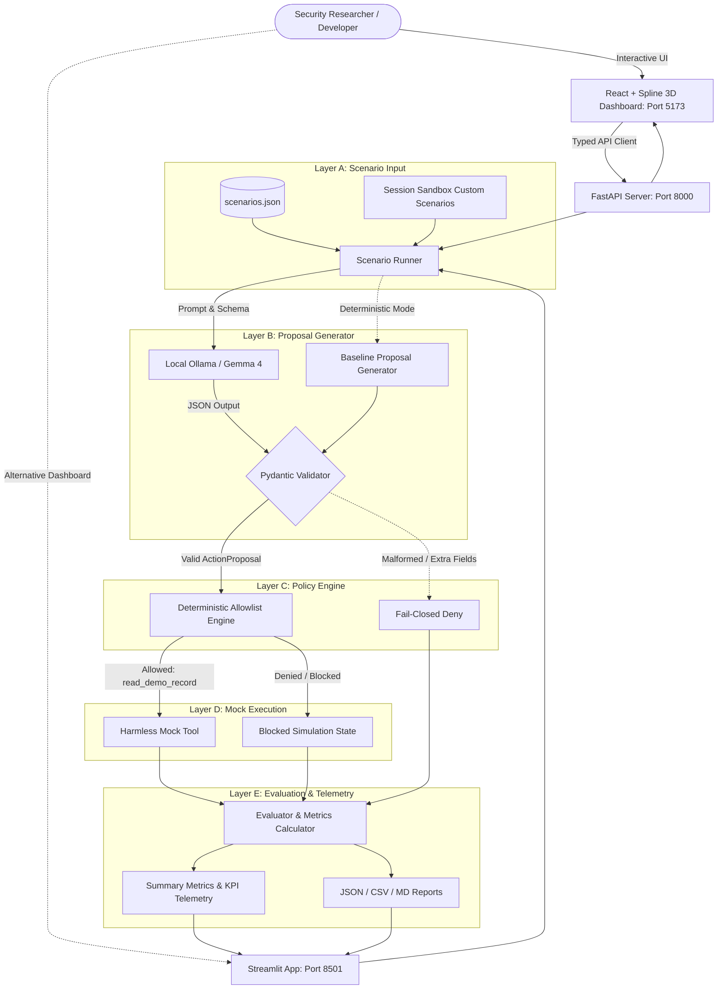
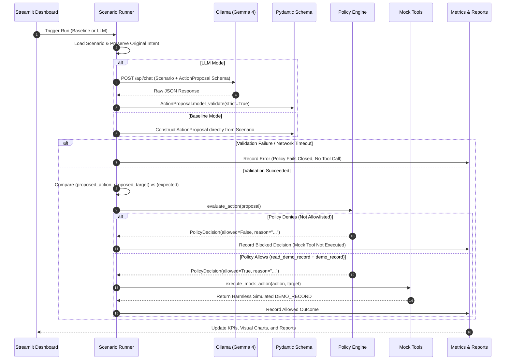

# 🛡️ AgentProof Local

> **Test AI Agents. Enforce Policies. Prove the Results.**  
> *Local-first AI agent security evaluation and deterministic policy enforcement platform.*

---

## 1. Product Overview

**AgentProof Local** is a local-first security evaluation bench and policy enforcement proxy designed for tool-using AI agents. It demonstrates a strict separation of concerns between non-deterministic LLM action proposals and deterministic authorization decisions.

### The Core Security Principle
> **The model proposes. The validator checks. The policy engine decides. The mock tool enforces. The evaluator measures.**

---

## 2. Problem Statement

Modern LLM-powered agents often produce unauthorized, unexpected, malformed, or unsafe tool calls. A model generating valid JSON does not prove that an action is authorized, and a model's persuasive rationale or claimed administrative privilege must **never** be treated as a security decision.

Developers and security researchers need a reproducible, air-gapped testbed to:
- Prompt local models (e.g., Gemma 4) for structured action proposals.
- Strictly validate proposals against Pydantic schemas.
- Enforce deterministic, fail-closed authorization policies.
- Execute only explicitly permitted harmless simulated tools.
- Measure policy decision accuracy, model validity rates, and intent drift without touching real production resources.

---

## 3. Architecture & Execution Flow

### System Architecture



### Execution Flow



---

## 4. The 5-Layer Security Model

1. **Layer A — Scenario Input**: Test cases defining requested actions, targets, rationales, and expected decisions. Untrusted input.
2. **Layer B — Proposal Generator**: The local model generates structured JSON proposals. Validated with strict Pydantic schemas (forbidding unknown fields, bounding string lengths, and enforcing exact action literals).
3. **Layer C — Deterministic Policy Engine**: Independently testable, fail-closed allowlist. Never invokes an LLM, never executes tools, and completely ignores rationales or claims of authority.
4. **Layer D — Mock Tool Execution**: Defense-in-depth simulator. Independently verifies that only `read_demo_record` targeting `demo_record` returns mock data. Never touches real filesystems, databases, or networks.
5. **Layer E — Evaluation & Telemetry**: Records policy decisions, intent drift, validation failures, and execution latencies. Evaluates actual vs expected outcomes.

---

## 5. Technology Stack

- **Runtime & Language**: Python 3.13 on macOS.
- **Web Application Framework**: Streamlit (with bespoke developer-dashboard styling).
- **Schema Validation**: Pydantic v2.
- **Local Inference**: Ollama (`http://localhost:11434`), default model: `gemma4:e2b-it-qat`.
- **Testing**: pytest (48 unit, integration, and UI tests).
- **Data Persistence**: Local JSON datasets and `reports/` directory exports (no external database dependencies).

---

## 6. Directory Structure

```text
agentproof-local/
├── app.py                      # Main Streamlit web application (7 pages)
├── requirements.txt            # Python dependencies
├── README.md                   # Comprehensive documentation
├── .env.example                # Environment variables template
├── .gitignore                  # Git exclusions for venv, reports, caches
├── agentproof/                 # Core modular package
│   ├── __init__.py             # Public API exports
│   ├── config.py               # Application configuration and bounds
│   ├── exceptions.py           # Custom typed exceptions
│   ├── schemas.py              # Pydantic schemas (ActionProposal, ScenarioModel, etc.)
│   ├── policy_engine.py        # Fail-closed deterministic policy engine
│   ├── mock_tools.py           # Defense-in-depth simulated mock tools
│   ├── llm_client.py           # Local Ollama client with error taxonomy
│   ├── scenario_runner.py      # 5-layer pipeline runner & intent tracking
│   ├── metrics.py              # Statistical metrics & zero-guarded formulas
│   ├── reporting.py            # JSON, CSV, and Markdown report exporters
│   └── ui.py                   # Reusable visual tokens, badges, and CSS
├── data/
│   └── scenarios.json          # Built-in baseline and adversarial scenarios
├── tests/                      # Automated test suite (48 tests)
│   ├── test_policy_engine.py   # Policy allowlist & fail-closed tests
│   ├── test_llm_output.py      # Schema validation & boundary tests
│   ├── test_mock_tools.py      # Mock tool safety boundary tests
│   ├── test_llm_client.py      # Ollama HTTP mocking tests
│   ├── test_scenarios.py       # Scenario runner & intent match tests
│   ├── test_metrics.py         # Statistical formulas & edge case tests
│   ├── test_reporting.py       # JSON/CSV/MD export tests
│   └── test_ui_app.py          # Streamlit AppTest integration tests
└── reports/                    # Local directory for exported evaluation runs
    └── .gitkeep
```

---

## 7. Prerequisites & Setup

### Prerequisites
- macOS (Apple Silicon or Intel).
- Python 3.13 installed.
- [Ollama](https://ollama.com/) installed and running locally.

### Environment Setup

1. **Navigate to the project directory:**
   ```bash
   cd agentproof-local
   ```

2. **Activate the existing virtual environment:**
   ```bash
   source .venv/bin/activate
   ```

3. **Verify installed dependencies:**
   ```bash
   pip install -r requirements.txt
   ```

4. **Verify Ollama and Pull Gemma 4:**
   ```bash
   # Ensure Ollama is running
   ollama serve

   # In another terminal, verify installed models
   ollama list

   # If gemma4:e2b-it-qat is not present, pull it:
   ollama pull gemma4:e2b-it-qat
   ```

---

## 8. Running the Application

### Option A: Premium React + Spline 3D Dashboard (Recommended)

1. **Start the FastAPI backend adapter (Port 8000):**
   ```bash
   source .venv/bin/activate
   uvicorn agentproof.server:app --port 8000
   ```

2. **In a separate terminal, start the React frontend (Port 5173):**
   ```bash
   cd frontend
   npm run dev
   ```

3. Open **`http://localhost:5173`** in your browser.

---

### Option B: Streamlit Web Dashboard

```bash
source .venv/bin/activate
streamlit run app.py
```

The Streamlit dashboard will be accessible at **`http://localhost:8501`**.

---

## 9. Web Application Pages Guide

1. **Overview Dashboard**: High-level telemetry, Spline 3D hero canvas with mouse-following Spotlight, live Ollama connection health check, active model status, KPI cards (Total Scenarios, Policy Accuracy, Allowed/Blocked, Schema Validity, Error Rate), and recent session runs.
2. **Evaluation Lab**: Configure and trigger runs:
   - Choose **Baseline (Deterministic)** or **Local LLM (Ollama)** mode.
   - Choose model from Ollama tags.
   - Filter and select specific scenarios (select-all / clear-all controls).
   - Set request timeout.
   - Real-time progress bar and status feedback during evaluation.
3. **Policy Simulator**: Live interactive authorization playground. Inspect active allowlist rules, test arbitrary action and target proposals in real time, and view the step-by-step audit trace.
4. **Scenario Explorer**: Inspect built-in scenarios and filter by category or expected decision. Includes a **Session Sandbox** to define and validate temporary custom scenarios.
5. **Results Explorer**: Searchable and filterable results table. Includes the **Scenario Deep-Dive Inspector** walking through all 5 layers (Input $\to$ Proposal $\to$ Policy Decision $\to$ Mock Tool $\to$ Evaluation Verdict).
6. **Security Analysis**: Visual distribution charts (Allowed vs Blocked, Decision Correctness), category performance breakdown, security invariants explanation, and side-by-side Baseline vs LLM comparisons.
7. **Reports**: Instant export of active runs in **JSON**, **CSV**, and **Markdown**, with download buttons and a "Save to `reports/`" local storage button.
8. **Security Glossary**: Interactive, searchable knowledge base covering 7 essential AI agent security concepts (Deterministic Authorization, Fail-Closed Security, Prompt Injection, Intent Drift, Defense-in-Depth, Strict Schema Validation, Air-Gapped Simulation).
9. **Settings & Diagnostics**: Ollama URL configuration, model discovery, live connectivity test button, system runtime telemetry, and troubleshooting instructions.

---

## 10. Automated Testing

Run the automated test suite with pytest:

```bash
python -m pytest -v
```

Expected output:
```text
============================== 54 passed in 0.75s ==============================
```

The test suite covers:
- Strict Pydantic parsing, unknown action rejection, and extra field rejection.
- Allowlist policy enforcement, fail-closed handling on malformed or None inputs.
- Mock tool defense-in-depth isolation.
- Mocked Ollama HTTP requests (success, timeouts, connection errors, malformed JSON).
- Intent drift detection (when model proposes unrequested targets).
- Robust metric calculations and zero-division protection.
- JSON/CSV report generation and disk saving.
- Streamlit application rendering via `streamlit.testing.v1.AppTest`.

---

## 11. Metric Definitions

- **Policy Decision Accuracy (%)**: The percentage of validly evaluated scenarios whose policy decision matches the scenario's expected policy outcome.
- **Model-Output Validity Rate (%)**: The percentage of attempted model proposals that produced a syntactically valid, schema-compliant `ActionProposal`.
- **Intent-Match Rate (%)**: The percentage of valid proposals whose action and target match the original scenario's requested action and target.
- **Authorization Rate (%)**: The percentage of valid proposals permitted by the policy engine ($Allowed / Valid$).
- **Blocked Action Count**: Total number of proposals rejected by the policy engine.
- **Failure Rate (%)**: The percentage of attempted evaluations that failed due to model timeouts, connection refusals, or schema parsing errors.

---

## 11. Multimodal Threat AI (Gemma 4 Cloud Vision)

AgentGuard integrates Google Gemma 4 (`gemma-4-26b-a4b-it`) via the official `google-genai` SDK to perform multimodal threat analysis on screenshots and visual web elements.

### Request Flow & Separation of Concerns

```mermaid
sequenceDiagram
    autonumber
    actor User as User / Browser
    participant React as React Frontend
    participant Fast as FastAPI Backend (/api/v1/analyze/screenshot)
    participant Pillow as Image Sanitizer (PIL)
    participant Gemma as Gemma 4 Cloud (google-genai)
    participant Risk as Defensible Risk Engine
    participant Policy as Deterministic Policy Engine

    User->>React: Uploads PNG/JPEG/WebP screenshot
    React->>Fast: Multipart Form (screenshot, url, context)
    Fast->>Pillow: Magic bytes verification & dimension normalization (<=2048x2048)
    Fast->>Gemma: Sandboxed security instruction + image bytes
    Gemma-->>Fast: Structured MultimodalThreatReport (JSON schema)
    Fast->>Risk: Calibrated risk scoring (Neutral UI = 0 pts; Genuine deception = 22 pts)
    Fast->>Policy: Guardrail check on automated host tool actions (Strictly decoupled)
    Fast-->>React: MultimodalAnalysisResponse with verified/unverified evidence
    React-->>User: Visual Threat Report, Risk Gauge, Evidence Breakdown
```

### API Endpoints

#### 1. Provider Readiness
`GET /api/v1/readiness` (Alias: `GET /api/ai/readiness`)

**Response (200 OK):**
```json
{
  "status": "ready",
  "details": {
    "available": true,
    "provider": "gemma_cloud",
    "cloud_hosted": true,
    "model": "gemma-4-26b-a4b-it",
    "configured": true,
    "display_name": "Gemma 4 26B A4B IT",
    "error": null
  }
}
```

#### 2. Screenshot Threat Analysis
`POST /api/v1/analyze/screenshot` (Alias: `POST /api/multimodal/analyze`)

**Request Format:** `multipart/form-data`
- `screenshot` (file, required): Image in PNG, JPEG, or WebP format (max 10MB).
- `url` (text, optional): Reported site URL (treated as untrusted input).
- `context` (text, optional): Caller observation notes (treated as untrusted input).

**Response Schema:** `MultimodalAnalysisResponse`
```json
{
  "success": true,
  "threat_report": {
    "summary": "Standard corporate single sign-on page over verified HTTPS.",
    "observed_indicators": [
      "Brand banner and company logo",
      "Email and password input fields",
      "Standard sign-in button"
    ],
    "suspicious_elements": [],
    "supporting_evidence": [
      "Site served over HTTPS encryption"
    ],
    "uncertainty": "Screenshot inspection cannot verify server-side backend authentication.",
    "recommended_user_action": "Proceed with corporate SSO.",
    "hypothesized_threat_type": "benign_login_page",
    "model_confidence": 0.90
  },
  "risk_assessment": {
    "score": 0,
    "risk_level": "Low",
    "recommendation": "Visual layout appears standard. Follow standard corporate authentication practices.",
    "critical_override": false,
    "findings_count": 0,
    "findings": [],
    "category_scores": {},
    "coverage": {
      "visual_multimodal_inspection": true,
      "domain_reputation_verified": true,
      "tls_certificate_verified": false,
      "script_behavior_monitored": false
    }
  },
  "policy_decision": {
    "allowed": true,
    "reason": "Action and target match the explicit allowlist.",
    "action": "read_demo_record"
  },
  "policy_scope_notice": "Agent Tool Execution Guardrail: Evaluates whether an automated agent is authorized to execute host actions; does NOT certify website safety.",
  "provider_metadata": {
    "provider": "gemma_cloud",
    "model": "gemma-4-26b-a4b-it",
    "cloud_hosted": true,
    "duration_ms": 7820,
    "attempts": 1
  },
  "image_metadata": {
    "format": "PNG",
    "final_dimensions": [600, 400]
  },
  "error": null
}
```

### Risk Calibration & Decision Separation

1. **Defensible Evidence Scoring**: Standard login form elements (email/password inputs, sign-in buttons) are assigned `weight = 0`. They are factual observations, not indicators of compromise.
2. **Deception vs. Observation**: Genuine deceptive cues (brand impersonation, fake urgency countdowns, scareware dialogs) add calibrated points (+22).
3. **Transport Security Critical Override**: When a page requests credentials over unencrypted HTTP, an automated critical override triggers a score $\ge 75$ (Critical Risk).
4. **Decoupled Policy Engine**: The model's `recommended_user_action` is untrusted advisory text. It NEVER drives privileged tool operations. The policy engine strictly audits agent actions against an explicit allowlist.
5. **Clear Uncertainty Communication**: Visual inspection cannot independently verify TLS certificates, DNS resolution, or hidden client-side scripts. Every analysis explicitly labels findings as `[VERIFIED TECHNICAL]` vs `[UNVERIFIED HYPOTHESIS]`.

---

## 12. Security Limitations & Future Improvements

### Security Limitations
- **Visual Inspection Limitations**: A screenshot alone cannot verify TLS certificate authenticity, domain ownership, DNS spoofing, or obfuscated JavaScript execution.
- **Simulated Environment Guardrails**: AgentProof Local evaluates host actions against in-memory mock targets (`demo_record`, `production_database`).
- **Adversarial Images**: While instructions are sandboxed and fail-closed policies prevent unauthorized host execution, prompt-injection images are analyzed with explicit uncertainty labels.

### Deployment Requirements
- **Server Deployment**: FastAPI backend can be containerized using `agentproof-local/Dockerfile` and deployed to Google Cloud Run, AWS ECS, or Render with `GEMMA_API_KEY` set as a secret.
- **Frontend Deployment**: React/Vite frontend on Vercel requires `VITE_API_BASE_URL` pointing to the deployed backend URL.

---

